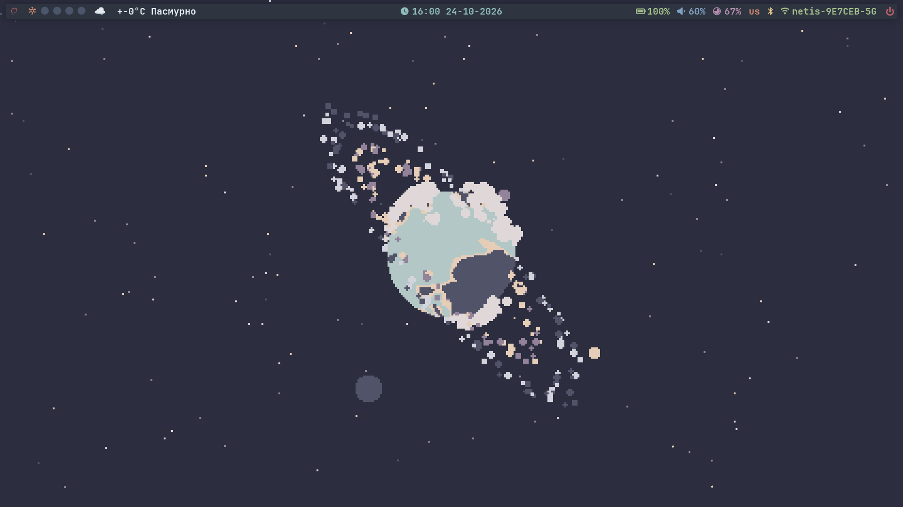
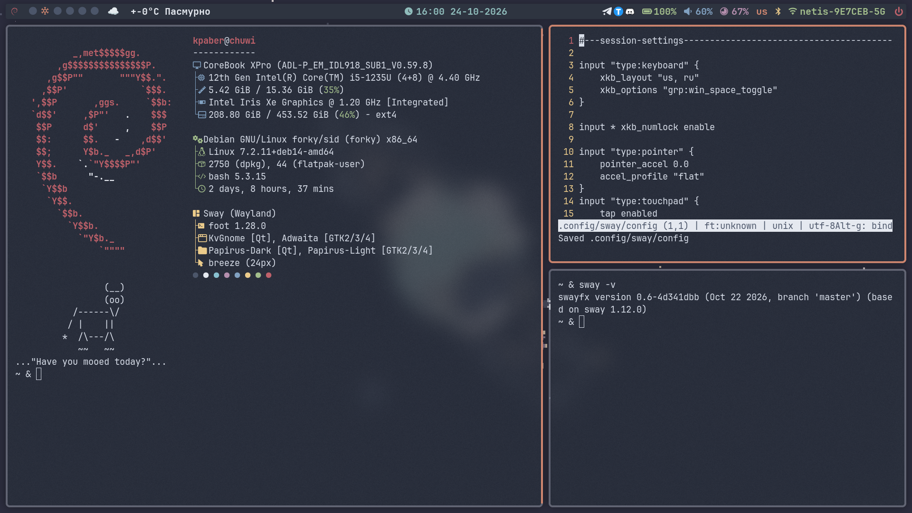
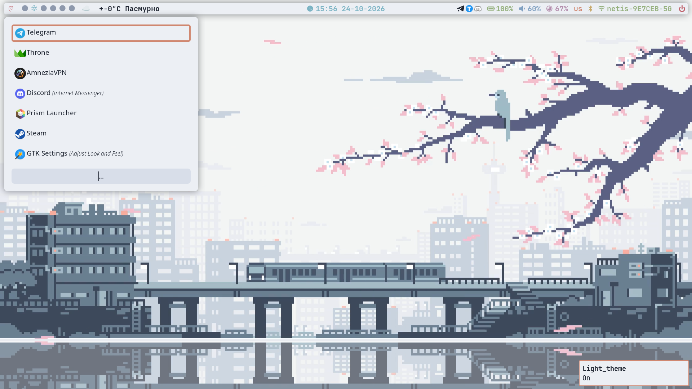

# **Мои дотфайлы для композитора swayfx**



*больше фото внутри репозитория*

Этим "*окружением*" я пользуюсь на каждодневной основе и стараюсь
сохранять его минималистичность и простоту(устройства). Конфиги довольно просто
установить и оно не требует много ресурсов. 

## Что внутри?
- Конфиги для основных программ(список оных ниже)
- Светлая и темная тема в цветовой палитре Nord
- Скрипт смены темы для всех приложений:
	- gtk
	- qt
	- flatpak
	- Приложения считывающие системную тему
- Автостарт из TTY, если вы пользуетесь bash

## Программы(зависимости)
- [swayfx](https://github.com/wlrfx/swayfx)
- [swaylock-effects](https://github.com/hboetes/swaylock-effects)
- autotiling
- rofi
- waybar
- dunst
- foot
- kvantummanager
- stow
- xdg-desktop-portal-wlr{gtk}
- И лично я использую
	- xfce4-power-manager
	- blueman-manager
	- iwgtk
	- pavucontrol
	- grim + slurp + swappy
- Но вы можете использовать что-то вроде
	- [rofi-bluetooth](https://github.com/nickclyde/rofi-bluetooth)
	- [rofi-wifi-menu](https://github.com/ericmurphyxyz/rofi-wifi-menu)

## Перед установкой важно сказать, что это сугубо личные дотфайлы
Я делал их для себя, под свое использование, под свой сетап, поэтому вам,
вероятно, придется поправить конфиги под себя и под свои нужды.

## Установка
- Для начала вам стоит установить swayfx, swaylock-effects, rofi, etc
в ваш дистрибутив доступным вам методом. В случае debian, местами, это сборка из
исходников. 
- Добавьте в $PATH путь $HOME/.local/bin, если еще нет
- Склонируйте репозиторий
```bash
git clone https://github.com/Kpaber/swayfx-dotfiles.git
#Далее переходим в папку и выполняем stow
cd swayfx-dotfiles
stow .
```
- Следующим шагом советую выполнить `theme-switcher`, т.к из-за
специфики скрипта смены тем часть конфигов это симлинки.
- Далее если используете flatpak, необходимо выполнить
```bash
flatpak {--user} override --filesystem=xdg-config/Kvantum:ro \
						  --filesystem=xdg-config/gtk-3.0:ro \
						  --filesystem=xdg-config/gtk-4.0:ro \
						  --filesystem=xdg-data/themes:ro \
						  --filesystem=xdg-data/icons:ro \
						  --env=QT_STYLE_OVERRIDE=kvantum
#также установите flatpak версию kvantum
#теперь все приложения должны выглядеть единообразно
```
- Если не устраивает системный шрифт, его легко поменять через nwg-look
- Далее настройте под **свой** сетап

## Горячие клавиши

**Модификаторы:**
- **`$mod`** = `Mod4` (клавиша **Super / Windows** )
- **`$mod_alt`** = `Mod1` (клавиша **Alt**)

**Запуск приложений и скриптов**

| Комбинация клавиш | Действие |
| :--- | :--- |
| `$mod` + `D` | Запустить меню приложений (**Rofi**) |
| `$mod` + `P` | Меню питания (**power.sh**) |
| `$mod` + `Return` | Терминал (**foot**) |
| `$mod` + `B` | Браузер (**Firefox**) |
| `$mod` + `C` | Калькулятор (**Qalculate**) |
| `$mod` + `F` | Файловый менеджер (**Thunar**) |
| `$mod` + `V` | Настройки звука (**pavucontrol**) |
| `$mod` + `I` | Настройки Wi-Fi (**iwgtk**) |
| `$mod` + `X` | Настройки питания XFCE |
| `$mod` + `M` | Трансляция экрана eDP-1 (**wl-mirror**) |
| `$mod` + `T` | Переключатель тем (**theme-switcher**) |

**Скриншоты**

| Комбинация клавиш | Действие |
| :--- | :--- |
| `$mod` + `S` | Сделать снимок всего экрана (и открыть в **Swappy**) |
| `$mod` + `Shift` + `S` | Выделить область (через **Slurp**) и открыть в **Swappy** |

**Управление окнами и системой**

| Комбинация клавиш | Действие |
| :--- | :--- |
| `$mod` + `Q` | Закрыть текущее окно (`kill`) |
| `$mod` + `Shift` + `C` | Перезапустить Sway (`restart`) |
| `$mod` + `Alt` + `R` | Перезагрузить конфиг Sway (`reload`) |
| `$mod` + `Alt` + `Q` | Выйти из Sway (`swaymsg exit`) |
| `$mod` + `L` | Заблокировать экран (**swaylock**) |
| `$mod` + `Alt` + `F` | Развернуть/свернуть окно на весь экран |
| `$mod` + `Alt` + `S` | Включить/выключить плавающий режим (`floating toggle`) |
| `$mod` + `Shift` + `Space`| Переключить фокус между плавающими/тайловыми окнами |

**Навигация и перемещение окон**

| Комбинация клавиш | Действие |
| :--- | :--- |
| `$mod` + `Стрелки` | Переключить фокус на окно в заданном направлении |
| `$mod` + `Shift` + `Стрелки` | Двигать окно на 40px в заданном направлении |
| `$mod` + `Ctrl` + `Стрелки` | Поменять местами текущее окно с соседним (Mark/Swap) |

**Рабочие столы**

| Комбинация клавиш | Действие |
| :--- | :--- |
| `$mod` + `1..9` | Переключиться на рабочий стол 1..9 (на экране **eDP-1**) |
| `$mod` + `0` | Переключиться на рабочий стол 10 (на экране **HDMI-A-1**) |
| `$mod` + `Shift` + `1..9`| Переместить активное окно на рабочий стол 1..9 |
| `$mod` + `Shift` + `0`| Переместить активное окно на рабочий стол 10 |

**Звук и Яркость**

| Комбинация клавиш | Действие |
| :--- | :--- |
| `F1`, `F2`, `F3` (с `Alt`) | **Звук:** Выключить / Тише / Громче |
| `F11`, `F12` (с `Alt`) | **Яркость:** Ниже / Выше |
| `XF86AudioRaiseVolume` | **Звук:** Громче (+2%) |
| `XF86AudioLowerVolume` | **Звук:** Тише (-2%) |
| `XF86AudioMute` | **Звук:** Выключить/Включить звук |
| `XF86MonBrightnessUp` | **Яркость:** Выше (+2%) |
| `XF86MonBrightnessDown` | **Яркость:** Ниже (-2%) |

**Режим изменения размера**

*Активируется нажатием `$mod` + `R`. Для выхода нажми `Return`, `Escape` или снова `$mod` + `R`.*

| Комбинация клавиш | Действие |
| :--- | :--- |
| `Стрелка Влево` | Уменьшить ширину окна |
| `Стрелка Вправо` | Увеличить ширину окна |
| `Стрелка Вверх` | Уменьшить высоту окна |
| `Стрелка Вниз` | Увеличить высоту окна |

## Известные проблемы
- Многочисленные баги анимаций
	- решается их отключением в .config/sway/config
- Проблемы с расположений игр в сетке воркспейса
	- установите gamescope или cage(для игр вроде Project Zomboid, которые
	тормозят через gamescope. Просто запустите steam внутри cage)
- Перестают отображаться окна на внешнем мониторе после гибернации или 
в этом духе
	- виноваты анимации, но я предпочитаю переткнуть монитор


